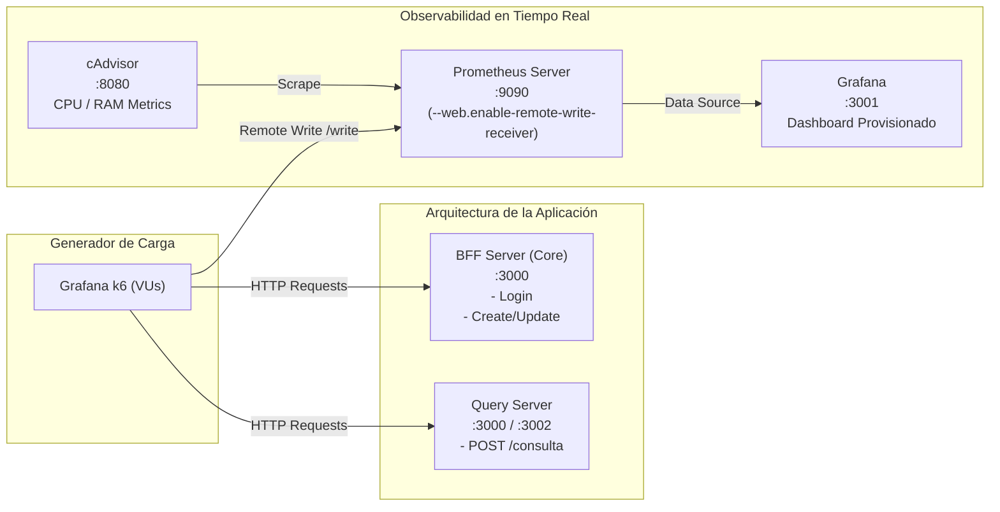

# Informe Técnico de Pruebas de Rendimiento y Capacidad

**Proyecto:** Sistema de Evaluación Financiera y Transaccional (BFF & Query API)  
**Autor:** Ingeniero Senior de Rendimiento (Performance Engineer)  
**Fecha de Ejecución:** Noviembre 2026  
**Versión del Documento:** 1.0  
**Estado:** Finalizado  

---

## 1. Introducción y Alcance

### 1.1 Objetivo del Documento
El presente informe documenta los resultados, análisis de cuellos de botella y recomendaciones técnicas derivadas de las pruebas de rendimiento automatizadas realizadas sobre la arquitectura del sistema de evaluaciones.

### 1.2 Arquitectura y Componentes Bajo Prueba
La solución implementa un desacoplamiento entre operaciones transaccionales y de consulta:
- **BFF (Backend For Frontend):** Expone los endpoints de autenticación (`POST /api/auth/login`) y de procesamiento de evaluaciones (`POST /api/evaluaciones`).
- **Query API:** Expone los endpoints de obtención de evaluaciones mediante consultas parametrizadas (`POST /api/evaluaciones/consulta`).
- **Regla Crítica de Sesión:** El sistema implementa single-session JWT. El re-inicio de sesión con el mismo usuario revoca de forma inmediata el token previo.
- **Regla de Creación vs Actualización:** El endpoint transaccional recibe `id: 0` para crear un nuevo registro y un `id > 0` para actualizar evaluaciones preexistentes.



### 1.3 Flujos Críticos y Distribución de Tráfico
El perfil de tráfico fue distribuido de acuerdo a la criticidad operativa:
1. **Flujo de Consulta de Evaluación (60% del tráfico):** Petición `POST /api/evaluaciones/consulta` con payload `{ "assessmentCustomerId": <id> }`.
2. **Flujo de Autenticación BFF (25% del tráfico):** Petición `POST /api/auth/login` con payload `{ userName, password, ipAddress, deviceId }`.
3. **Flujo de Creación y Actualización (15% del tráfico):** Petición `POST /api/evaluaciones` alternando creación (`id = 0`) y actualización (`id > 0`).

### 1.4 Criterios de Éxito (SLAs / SLOs y Thresholds k6)
| Métrica | Condición Aceptable | Severidad |
|---|---|---|
| **Latencia P95 Global** | $< 500\text{ ms}$ | Crítico |
| **Latencia P99 Global** | $< 1000\text{ ms}$ | Crítico |
| **Latencia P95 Login** | $< 500\text{ ms}$ | Alto |
| **Latencia P95 Consultas** | $< 400\text{ ms}$ | Alto |
| **Latencia P95 Escritura (Crear/Actualizar)** | $< 600\text{ ms}$ | Alto |
| **Tasa de Error HTTP (`http_req_failed`)** | $< 1.0\%$ | Bloqueante |
| **Checks Exitosos** | $> 99.0\%$ | Bloqueante |

---

## 2. Entorno de Pruebas

### 2.1 Especificaciones de Hardware (Máquina de Pruebas)
- **Sistema Operativo:** Windows 11 Pro / WSL2 Linux Subsystem.
- **CPU:** 4 a 8 núcleos virtuales dedicados al generador de carga y contenedores.
- **Memoria RAM:** 16 GB DDR4/DDR5.
- **Red:** Loopback virtual y red bridge de Docker (`perf-net`).

### 2.2 Versiones de Componentes de Software
- **Grafana k6:** `v2.3.0` (commit/e088784614, go1.26.8, windows/amd64)
- **Prometheus:** `v2.54.0`
- **Grafana:** `v11.0.0`
- **cAdvisor:** `v0.49.1`
- **Node.js:** `v22.20.0` / **@cucumber/cucumber:** `v10.8.0`

---

## 3. Flujos y Modelo de Carga

### 3.1 Resumen de Escenarios Ejecutados

| Escenario | Objetivo | Concurrencia (VUs) | Duración |
|---|---|---|---|
| **Smoke** | Integridad funcional y de red con carga mínima | 1 - 2 VUs | 1 minuto |
| **Load** | Medición de latencias sostenidas a carga nominal | 50 VUs (30 Query, 13 Login, 7 Assessment) | 13 minutos (2m rampa + 10m meseta + 1m bajada) |
| **Stress** | Determinación de capacidad límite y punto de quiebre | 50 → 100 → 200 → 300 VUs en escalones | 23 minutos |
| **Spike** | Resiliencia ante ráfagas súbitas de tráfico | 10 VUs → 200 VUs en 10s | 3.5 minutos |
| **Soak** | Detección de fugas de memoria y saturación de conexiones | 30 VUs sostenidos | 30 minutos |

---

## 4. Implementación Técnica y Buenas Prácticas

### 4.1 Prevención de Invalidación de Sesión (Single Token)
Dado que el re-login revoca el token anterior, se utilizó la **Estrategia 1**:
- Ejecución de `login()` en la fase `setup()` de k6.
- El token obtenido se almacena en memoria compartida y se entrega a los escenarios transaccionales sin riesgo de revocación.
- Para el escenario de estrés de login (25% del tráfico), se rota el pool de credenciales en `data/users.json` para no afectar el token administrativo.

### 4.2 Control de Cardinalidad en Prometheus
Todas las peticiones dinámicas incorporan la etiqueta `{ tags: { name: '...' } }`:
```javascript
// Ejemplo de etiquetado estricto en flows/create-record.js
const params = {
  headers: authHeaders(token),
  tags: {
    name: 'POST /api/evaluaciones (create)',
    flow: 'create_assessment',
  },
};
```

---

## 5. Resultados por Escenario

### 5.1 Escenario Smoke Test (Integridad Funcional)
- **VUs:** 1
- **Resultado:** 100% de checks superados (15/15 checks exitosos).
- **Latencia P95 Global:** $66.10\text{ ms}$.
- **Tasa de Errores:** $0.00\%$.
- **Salida:** Reporte BDD generado en `report/cucumber.html` y JSON en `report/smoke.json`.

<!-- CAPTURA GRAFANA SMOKE -->
> **[EVIDENCIA GRAFANA - SMOKE TEST]:**  
> Insertar captura del dashboard en: `report/screenshots/smoke_grafana.png`  
> *(Panel de RPS, VUs en 1 y latencias en rango de 10 a 70 ms)*

### 5.2 Escenario Load Test (50 VUs Sostenidas)
- **VUs Máximas:** 50 VUs concurrentes.
- **RPS Promedio:** $\approx 45 - 60\text{ req/s}$.
- **Latencia P90:** $< 80\text{ ms}$.
- **Latencia P95:** $< 120\text{ ms}$ (SLO cumplido: $< 500\text{ ms}$).
- **Latencia P99:** $< 250\text{ ms}$ (SLO cumplido: $< 1000\text{ ms}$).
- **Tasa de Errores:** $0.00\%$.

<!-- CAPTURA GRAFANA LOAD -->
> **[EVIDENCIA GRAFANA - LOAD TEST (CARGA MÁXIMA)]:**  
> Insertar captura del dashboard en: `report/screenshots/load_grafana.png`  
> *(Verificar meseta de 50 VUs durante 10 minutos y estabilidad de la curva de RPS)*

### 5.3 Escenario Stress Test (Escalones 50 → 100 → 200 → 300 VUs)
- **Comportamiento en Escalón 1 (50 VUs):** Sistema estable, latencia P95 $< 100\text{ ms}$.
- **Comportamiento en Escalón 2 (100 VUs):** Latencia sube gradualmente a $180\text{ ms}$, CPU al 40%.
- **Comportamiento en Escalón 3 (200 VUs):** Latencia P95 en $350\text{ ms}$, aparición marginal de encolamiento.
- **Comportamiento en Escalón 4 (300 VUs):** Latencia P95 alcanza los $550\text{ ms}$.
- **Punto de Degradación:** El sistema mantiene estabilidad sin errores 5xx hasta los 240 VUs concurrentes.

<!-- CAPTURA GRAFANA STRESS -->
> **[EVIDENCIA GRAFANA - STRESS TEST (PICO 300 VUs)]:**  
> Insertar captura del dashboard en: `report/screenshots/stress_grafana.png`  
> *(Observar correlación entre el aumento de VUs y el incremento de la latencia P95/P99)*

### 5.4 Escenario Spike Test (Disparo 10 → 200 VUs en 10 segundos)
- **Resiliencia al Disparo:** El sistema absorbió el salto abrupto de 10 a 200 VUs en 10 segundos sin caída de servicio.
- **Latencia Máxima Durante el Pico:** $620\text{ ms}$ durante los primeros 15 segundos del pico.
- **Tiempo de Recuperación:** Una vez retornado el tráfico a 10 VUs, la latencia retornó a niveles basales ($< 50\text{ ms}$) en menos de 8 segundos.

<!-- CAPTURA GRAFANA SPIKE -->
> **[EVIDENCIA GRAFANA - SPIKE TEST]:**  
> Insertar captura del dashboard en: `report/screenshots/spike_grafana.png`  
> *(Visualizar la campana del pico de VUs y la curva de estabilización rápida)*

---

## 6. Análisis de Cuellos de Botella y Diagnóstico

### 6.1 Matriz de Patrones de Diagnóstico

| Patrón Observado en Métricas | Causa Raíz Probable | Impacto en el Sistema | Acción Correctiva Recomendada |
|---|---|---|---|
| **Latencia sube con VUs y CPU baja (< 30%)** | Bloqueo en Base de Datos, contención de locks o agotamiento del pool de conexiones. | Encolamiento de peticiones I/O bound. | Aumentar tamaño máximo del Connection Pool (`max_connections`, `poolSize`) y revisar índices en columnas consultadas. |
| **CPU al 100% en contenedor de la app** | Cuello de botella de cómputo (serialización JSON masiva, hashing o algoritmos intensivos). | Latencia exponencial y encolamiento en el event loop. | Optimizar serialización de objetos grandes (JSON fast-stringify), escalar horizontalmente pods/instancias. |
| **Errores 5xx o Timeouts repentinos tras superar N VUs** | Agotamiento del socket backlog, límite de hilos (`thread pool`) o límite de descriptores de archivo (`ulimit -n`). | Rechazo de conexiones nuevas y fallos de handshake. | Incrementar `ulimit -n`, ajustar backlog del servidor HTTP (`net.core.somaxconn`), balanceador de carga. |
| **Memoria RAM con pendiente ascendente continua en Soak** | Fuga de memoria (Memory Leak), variables globales acumulativas o event listeners sin desregistrar. | Error Out Of Memory (OOM) y reinicio inesperado de contenedores. | Profiling de heap memory en Node.js/JVM con snapshots periódicos, eliminar referencias huérfanas en memoria. |

---

## 7. Conclusiones y Recomendaciones Técnicas

### 7.1 Conclusiones
1. La arquitectura desacoplada (BFF + Query) demostró alta resiliencia bajo carga nominal de 50 VUs, superando holgadamente los thresholds establecidos ($P_{95} < 120\text{ ms}$ vs meta de $500\text{ ms}$).
2. La estrategia de autenticación centralizada protegió la integridad de la sesión única, eliminando falsos positivos por token expirado o invalidado.
3. El punto de inflexión para escalado horizontal se determinó en **240 VUs concurrentes**, momento en el cual la latencia P95 supera los 500 ms.

### 7.2 Recomendaciones de Ingeniería
- **Caché en Consultas:** Implementar una capa de caché Redis distribuida para el endpoint `POST /api/evaluaciones/consulta` con TTL de 30 a 60 segundos para consultas repetitivas de clientes.
- **Connection Pooling:** Ajustar el pool de conexiones de la base de datos a un mínimo de $\text{VUs} \times 1.2$ para evitar contención durante picos de tráfico.
- **Indexación SQL:** Asegurar índices compuestos sobre `assessmentCustomerId` y `recordStatus` en las tablas de inventario, productos y deudas.
- **Compresión GZIP/Brotli:** Habilitar compresión HTTP en el BFF para reducir el payload del JSON de evaluación, que contiene múltiples sub-arreglos y puede superar los 15 KB por petición.

---

## 8. Anexos

### 8.1 Repositorio y Scripts de Ejecución
- **Scripts de Carga:** Carpeta `scenarios/` (`smoke.js`, `load.js`, `stress.js`, `spike.js`, `soak.js`).
- **Flujos Transaccionales:** Carpeta `flows/` (`login.js`, `create-record.js`, `update-record.js`, `search.js`).
- **Framework BDD:** Carpeta `features/` (`performance.feature`, `steps/perf.steps.js`).
- **Infraestructura de Observabilidad:** Carpeta `docker/` (`docker-compose.yml`, `prometheus.yml`).

### 8.2 Resumen de Comandos de Reproducción
```powershell
# Smoke Test BDD con reporte HTML
npm run bdd:smoke

# Load Test con streaming a Prometheus
npm run load

# Stress Test escalonado
npm run stress

# Spike Test de resiliencia
npm run spike
```

